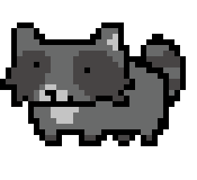

<p align='center'> 
  
</p>

## Hi there ＼(´人´)／！\

### Acho Annie

Annie is a little raccoon who digs through the internet for shiny things, and *sometimes* does git pushes.


```
                            ╭───────────────────────────────╮
                            │ I make the useful parts cute. │
                            ╰────╮ ╭────────────────────────╯
                                 │╱  
```
<div align="center"> 
 </div>


| | |
|---|---|
| species | raccoon (๑•̀ㅂ•́)و✧ |
| class | full-stack dev · artist |
| den | Leuven, Belgium 🇧🇪 |
| status | looking for a traineeship, Feb – May 2027 |


You can visit and type `hello` into the shell at [chamoannie.dev](https://chamoannie.dev)!


### ⋆˙⟡ Inventory ⟡˙⋆

- **Languages:** Python · JavaScript · TypeScript · Java · C# · SQL · Rust
- **Frontend:** React · Next.js · React Native · Tailwind CSS
- **Backend & data:** Spring Boot · PostgreSQL · Cosmos DB
- **Cloud & DevOps:** Azure · Docker · Kubernetes · GitHub Actions
- **Graphics:** Unity · HLSL shaders · mesh generation
- **Art:** Clip Studio Paint (pixel art is the most comfortable)

### Roles
- **Scrum Master**: kept the sprints rolling on a team web-app
- **Quality Assurance Lead**: hunt and keep the repo clean of bugs
- **Guide**: coaching college juniors git, logs and debugging
- **CoderDojo Coach**:


### ♪｡⋆ Stash ⋆｡♪ 

**ratito** · Pomodoro focus app with pixel-art animals and rewards
`TypeScript` `React Native` · [Code →](https://github.com/achoannie/ratito-pomodoro-app)

**pixel-up** · Pixel-art GIF upscaler that keeps the pixels crisp
`Rust` · [Code →](https://github.com/achoannie/pixel-up)

**chamoannie.dev** · My portfolio, with a little shell to play with
[Code →](https://github.com/achoannie/chamoannie.dev) · [Live →](https://chamoannie.dev)


### Quest log <sub>(2nd-year team & school projects)</sub>

**ProtonDB clone** · community site for reporting how games run on Linux<br>
Scrum Master & back end: entities, migrations, API integrations, customizable multilingual profiles, an AI help bot<br>
`Spring Boot` `Next.js` `PostgreSQL`

**UWA** · multilingual fitness app with sound effects and an animated mascot<br>
Serverless on Azure Functions with GitHub Actions CI/CD; I tamed the App Service deployment<br>
`Azure Functions` `Cosmos DB` `Docker` `GitHub Actions`

**Voxel terrain engine** · Minecraft-style terrain in Unity, meshes built by hand from vertex buffers<br>
`Unity` `C#` `HLSL`


<p align="center">
  
  
  
</p>


<p align="center">
  Find Annie:<br/>
  ✧ঌ <a href="https://chamoannie.dev">chamoannie.dev</a> ໒꒱･ﾟ✧
</p>

<p align="center">
  Support (˶ˆ ᵕ ˆ˵)つ☕<br/>
  <a href="https://ko-fi.com/chamoannie">Ko-fi</a> ・ <a href="https://buymeacoffee.com/chamoannie">Buy Me a Coffee</a>
</p>


<!-- <p align="center">
  
</p> -->


<!-- 
<p align="center">
  
  
  
</p> -->


<p align="center"><sub>dug up by Annie · last rummaged 2026.11</sub></p>