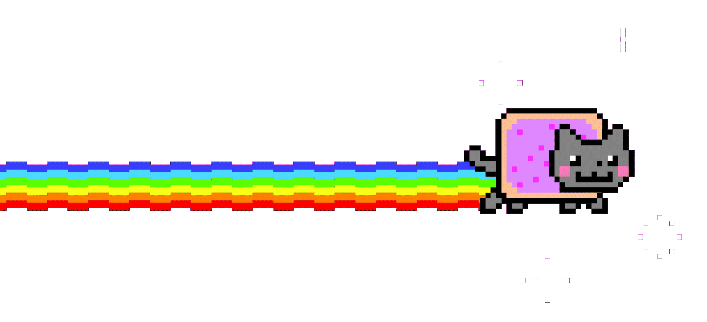

 
  

## Hi there ＼(´人´)／！

Art and Programming enthusiast!

Final-year dev student at UC Leuven-Limburg 🇧🇪. This is where I share what I build, draw, and break.

  

### ♪｡⋆ My projects ⋆｡♪

- **Apps**
  - [pomodoro-app](https://github.com/achoannie/pomodoro-app) - Pomodoro timer with pixel-art animal animations
- **Tools**
  - [pixel_up](https://github.com/achoannie/pixel-up) - Pixel-art GIF upscaler written in Rust
- **Web**
  - [portfolio](https://github.com/achoannie/chamoannie.dev) - My personal portfolio site

<!-- 

  

 -->

  
  
  

  my portfolio: 
  ✧･ﾟ꒰ঌ <a href="https://chamoannie.dev">chamoannie.dev</a> ໒꒱･ﾟ✧

  Support (˶ˆ ᵕ ˆ˵)つ☕ 
  <a href="https://ko-fi.com/chamoannie">Ko-fi</a> ・ <a href="https://buymeacoffee.com/chamoannie">Buy Me a Coffee</a>

